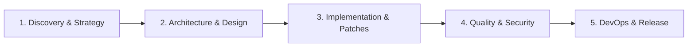

<div align="center">


<br />


# Recon — Autonomous SDLC Agentic Tool

### *The local-first AI software engineering command center powered by 25 specialized agent brains.*

**Zero Code Egress • Fail-Closed Governance • Compiler-Verified Patches • Instant npx Launch**

<br />

[](https://www.npmjs.com/package/@reconscanner/recon)
[](https://github.com/chandrahotha/Recon_SDLC_Agentic_Tool-P)
[](https://github.com/chandrahotha/Recon_SDLC_Agentic_Tool-P)
[](https://github.com/chandrahotha/Recon_SDLC_Agentic_Tool-P)
[](mailto:digi.tracks@outlook.com)

<br />

### 🚀 Instant Launch (Zero Installation Required)

```bash
npx @reconscanner/recon
```

*(Instantly downloads the lightweight ~9.5 MB runner and launches the native Recon desktop cockpit on Windows 10/11 x64.)*

<br />


<br />

[Quickstart](#-how-to-use-recon) • [Why Local-First?](#-why-local-first-zero-code-egress-vs-cloud-ai) • [The 25 Agent Brains](#-the-25-specialized-agent-brains) • [Enterprise Security](#-enterprise-security--privacy-first) • [Request Enterprise Pilot](#-enterprise-pilots--commercial-licensing)

</div>

---

## ⚡ What is Recon?

**Recon** is an autonomous, **local-first AI engineering command center** designed for software engineers, architects, security leaders, and DevOps teams. Rather than acting as a generic chat interface, Recon coordinates **25 specialized AI agent brains** across every phase of the Software Development Life Cycle (SDLC)—from initial discovery and architectural boundary modeling to automated static analysis (SAST), zero-downtime database migrations, and compiler-verified patch generation in isolated Git worktrees.

Recon is engineered with a strict **Zero Code Egress** philosophy: your proprietary source code, AST indexes, and repository history remain 100% on your local machine.

---

## 🛡️ Why Local-First? (Zero Code Egress vs Cloud AI)

| Capability | Cloud AI Assistants (Copilot, Cursor) | Recon Autonomous SDLC Tool |
| :--- | :---: | :---: |
| **Code Privacy & Egress** | ⚠️ Source code sent to third-party cloud servers | ✅ **100% Local-First** — Zero source code egress |
| **Air-Gapped Operation** | ❌ Requires continuous internet connection | ✅ Fully functional with local LLMs (Ollama / LM Studio) |
| **Multi-Agent Orchestration** | ❌ Single generic conversational prompt | ✅ **25 Specialized Brains** collaborating across SDLC stages |
| **Patch Safety & Verification** | ❌ Blind text suggestions without compilation check | ✅ **Sandboxed Git Worktrees** with atomic rollback |
| **Credential Protection** | ⚠️ Plaintext `.env` files or browser cookies | ✅ **Windows DPAPI** hardware-bound encryption at rest |
| **Audit & Governance** | ❌ Transient chat logs | ✅ Standalone HTML & PDF compliance reports with evidence lineage |

---

## 🚀 How to Use Recon

### Step 1: Launch the Cockpit
Execute the one-line command in any PowerShell or Command Prompt terminal:
```bash
npx @reconscanner/recon
```
*(Or install globally: `npm install -g @reconscanner/recon` and run `recon`)*

### Step 2: Connect Your Local Repository
In the **PROJECT** panel:
1. Enter your project name.
2. Select or enter your local repository path (e.g., `C:\Projects\my-app`).
3. Click **Register & Connect**. Recon immediately runs local AST indexing and repository fingerprinting.

### Step 3: Choose Your Model Gateway
Recon operates fully offline for repo scanning and AST analysis. To enable multi-agent reasoning:
* **Option A: 100% Air-Gapped via Local Ollama / LM Studio** (Recommended for total privacy)  
  Point Recon to `http://localhost:11434/v1`. Zero tokens leave your workstation.
* **Option B: Cloud Providers (NVIDIA NIM, OpenAI, Anthropic, Google Gemini)**  
  Enter your API credentials in **Settings → Provider Credentials**. Credentials are encrypted at rest using Windows DPAPI (tied to your Windows user account) and never stored in plaintext.

### Step 4: Run Autonomous SDLC Pipeline
Click **Start Autonomous SDLC Run**:
* Watch the **25-Brain Telemetry Strip** (*pulsing cyan = scanning, emerald = passed, amber = quality gate, ruby = failed*).
* Stream agent thoughts and reasoning in real time via local Server-Sent Events (SSE).

### Step 5: Review Verified Patches & Export Reports
* **Patch Review**: Inspect syntax-tinted git diffs with exact line numbers and `+added`/`-removed` stats. Accept or reject with one click.
* **Findings Browser**: Filter vulnerabilities and code smells by severity (*Critical, High, Medium, Low*).
* **Compliance Reports**: Export print-to-PDF ready, self-contained HTML audit reports containing executive verdicts, gate results, and evidence lineage.

---

## 🧠 The 25 Specialized Agent Brains

Recon structures your software development lifecycle across 5 high-efficiency stages:



| Phase | Brain | Core Mission | Code Write | Sandbox Exec |
| :--- | :--- | :--- | :---: | :---: |
| **Discovery & Strategy** | `idea` | Explores problem domain, edge cases, and risk factors | ❌ | ❌ |
| | `discovery` | AST repository indexing, framework detection, and fingerprinting | ❌ | ✅ *(scan)* |
| | `requirements` | Formulates testable user stories and quality gates | ❌ | ❌ |
| **Architecture & Design** | `architecture` | Component topology, system boundaries, and ADR records | ❌ | ❌ |
| | `planning` | Dependency task graphs and milestone execution schedules | ❌ | ❌ |
| | `ux-design` | UI interaction flows, design systems, and WCAG specs | ❌ | ❌ |
| **Implementation** | `coding-orchestrator`| Distributes tasks across isolated Git worktrees | ❌ | ❌ |
| | `frontend-coding` | Responsive UI components, state logic, and accessibility | ✅ *(patch)* | ✅ *(build)* |
| | `backend-coding` | Domain models, REST/gRPC endpoints, and service logic | ✅ *(patch)* | ✅ *(build)* |
| | `database` | Zero-downtime migrations, schema constraints, and query plans | ✅ *(patch)* | ✅ *(test)* |
| | `refactoring-debt` | Identifies complexity hotspots and safe refactoring paths | ❌ | ❌ |
| **Quality & Security** | `testing` | Unit, integration, property, and regression test suites | ❌ | ✅ *(test)* |
| | `security` | Static analysis (SAST), secret discovery, and CVE mitigation | ❌ | ❌ |
| | `compliance` | Open-source license governance and privacy rules | ❌ | ❌ |
| | `performance` | Complexity profiling, memory footprint, and latency audits | ❌ | ❌ |
| | `accessibility-i18n` | WCAG 2.1 AA audits, screen reader support, and localization | ❌ | ❌ |
| | `code-review` | Cross-discipline peer review against architectural contracts | ❌ | ❌ |
| **DevOps & Release** | `documentation` | OpenAPI specifications, developer docs, and changelogs | ❌ | ❌ |
| | `devops-cicd` | Production Dockerfiles, GitHub Actions/GitLab CI pipelines | ❌ | ❌ |
| | `finops` | Cloud resource rightsizing and cost optimization | ❌ | ❌ |
| | `observability` | OpenTelemetry tracing, Prometheus metrics, and structured logs | ❌ | ❌ |
| | `incident-triage` | Correlates runtime error telemetry with git revisions | ❌ | ❌ |
| | `release` | Release packaging, semantic versioning, and build checklists | ❌ | ❌ |
| **Continuous Learning** | `learning` | Synthesizes project heuristics from verified runs | ❌ | ❌ |
| | `continuous-improvement`| Recommends systemic architectural upgrades over time | ❌ | ❌ |

---

## 🛡️ Enterprise Security & Privacy-First

- **Zero Egress Architecture**: All repository files, AST parsing, and SQLite artifact storage remain on your local workstation.
- **Windows DPAPI Credential Protection**: API keys are encrypted at rest using Windows DPAPI (tied to your Windows user account)—never stored in plaintext or exposed to the UI renderer.
- **Sandboxed Worktree Execution**: Automated code generation executes in isolated, ephemeral Git worktrees with mandatory compilation checks and atomic rollback protection.
- **Fail-Closed Governance**: Every agent brain is governed by strict declarative contracts. Unauthorized writes or missing validation criteria halt execution immediately.

---

## 💼 Enterprise Pilots & Commercial Licensing

Recon is available for enterprise evaluation and pilot deployments:

* **Custom Agent Brains**: Trained on your private architectural guidelines, coding standards, and internal frameworks.
* **Team Governance & Control Plane**: Centralized audit trails, SSO/SAML integration, and team-wide policy enforcement.
* **On-Premise & Air-Gapped Deployments**: Dedicated enterprise setup for regulated defense, financial, and healthcare codebases.

### 📬 Request an Enterprise Pilot
Contact the Digi Tracks engineering team directly:  
📧 **[digi.tracks@outlook.com](mailto:digi.tracks@outlook.com?subject=Recon%20Enterprise%20Pilot%20Inquiry)**

---

<div align="center">

**Proprietary — © 2026 Digi Tracks. All rights reserved.**  
<sub>Engineering intelligence delivered directly to your desktop.</sub>

</div>
