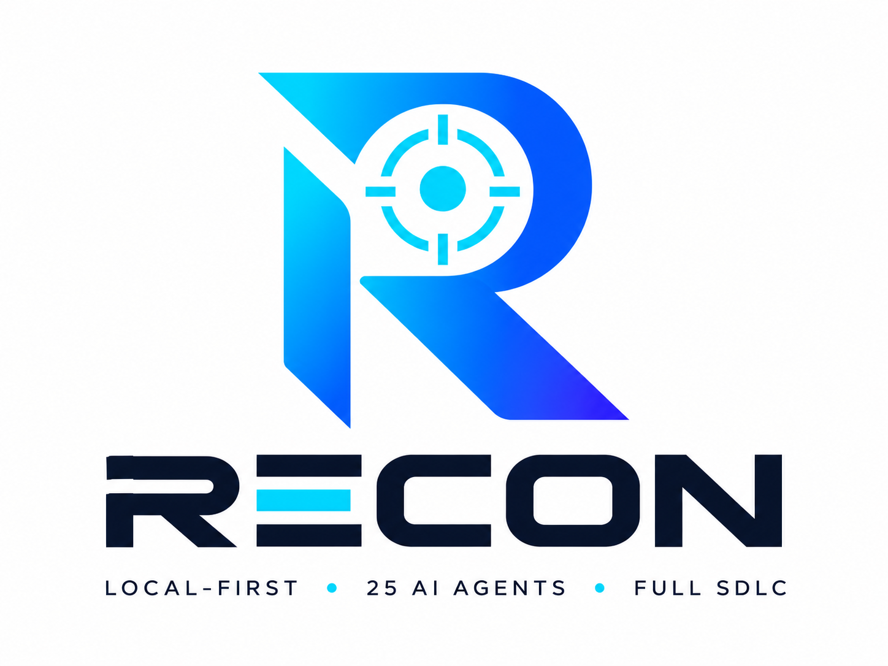
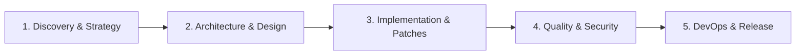

 

# Recon — Autonomous SDLC Agentic Tool

### *The local-first engineering command center powered by 25 specialized agent brains.*

**Zero Code Egress • Fail-Closed Governance • Sandboxed Verification • Single Portable .exe**

 

 

 

[Product Overview](./docs/product-overview.md) • [Features](./docs/features.md) • [Use Cases](./docs/use-cases.md) • [User Guide](./docs/user-guide.md) • [FAQ](./docs/faq.md) • [Changelog](./CHANGELOG.md) • [Security](./SECURITY.md)

---

## ⚡ What is Recon?

**Recon** is an autonomous, local-first desktop command center for engineering teams. It orchestrates **25 specialized AI agent brains** across every phase of the Software Development Life Cycle (SDLC)—from architecture and security static analysis to verified automated patch generation and release readiness.

Built as a single, self-contained desktop executable, Recon runs directly on your workstation without transmitting source code to third-party cloud services.

### Core Architectural Pillars

- 🔒 **100% Local-First & Zero Code Egress**  
  Source code parsing, AST indexing, security analysis, and diff generation execute locally. Code never leaves your machine unless you explicitly connect an external LLM endpoint.

- 🧠 **25 Dedicated Agent Brains**  
  Specialized, role-based agents collaborate across distinct lifecycle phases rather than relying on generic, monolithic prompts.

- 🛡️ **Fail-Closed Governance & Contracts**  
  Every agent operates under declarative contract constraints. Undeclared outputs, unauthorized writes, or missing validations immediately halt execution.

- 🧪 **Sandboxed Worktree Verification**  
  Code modifications are isolated within temporary Git worktrees. Every proposed change is compiled and validated prior to human presentation, with atomic rollback on failure.

- 👨‍💻 **Human-in-the-Loop Decision Gates**  
  Developers retain total control. Inspect syntax-tinted line-by-line diffs, evaluate categorized findings, and approve or reject changes with a single click.

---

## 🧭 The 25 Agent Lifecycle Matrix

| Lifecycle Stage | Agent Brain | Core Responsibility |
| :--- | :--- | :--- |
| **1. Discovery & Strategy** | `idea` | Explores problem domain, architectural constraints, and risk factors |
| | `discovery` | Scans workspace, detects frameworks, extracts AST and dependency maps |
| | `requirements` | Formulates structured user stories, acceptance criteria, and quality gates |
| **2. Architecture & Design** | `architecture` | Establishes component topologies, system boundaries, and ADR records |
| | `planning` | Generates dependency task graphs and milestone sequencing |
| | `ux-design` | Validates interaction flows, layout systems, and accessibility guidelines |
| **3. Implementation** | `coding-orchestrator`| Distributes implementation tasks across isolated Git worktrees |
| | `frontend-coding` | Develops responsive UI components, state management, and design systems |
| | `backend-coding` | Implements domain models, API endpoints, business logic, and validation |
| | `database` | Generates safe zero-downtime migrations, schema indexes, and query plans |
| | `refactoring-debt` | Identifies code complexity hotspots, technical debt, and safe refactoring paths |
| **4. Quality & Security** | `testing` | Creates comprehensive unit, integration, property, and regression suites |
| | `security` | Performs static analysis (SAST), secret detection, and vulnerability audit |
| | `compliance` | Validates open-source license governance, headers, and privacy rules |
| | `performance` | Analyzes execution bottlenecks, memory footprint, and query complexity |
| | `accessibility-i18n` | Audits WCAG 2.1 AA compliance, screen reader support, and localization |
| | `code-review` | Executes cross-discipline peer review against architectural contracts |
| **5. DevOps & Release** | `documentation` | Generates OpenAPI specifications, developer guides, and changelogs |
| | `devops-cicd` | Produces production Dockerfiles, CI/CD pipelines, and infrastructure checks |
| | `finops` | Models cloud infrastructure costs and rightsizing recommendations |
| | `observability` | Instruments OpenTelemetry tracing, Prometheus metrics, and structured logs |
| | `incident-triage` | Correlates error telemetry with git revisions for root-cause analysis |
| | `release` | Verifies release artifacts, semantic versioning, and build checklists |
| **Continuous Learning** | `learning` | Synthesizes project-specific heuristics from successful patch cycles |
| | `continuous-improvement`| Recommends systemic architectural enhancements over time |

---

## 🖥️ Command Center Cockpit

The Recon interface delivers a high-density, aerospace-inspired desktop cockpit engineered for professional developer workflows:

- **25-Brain Telemetry Strip**: Instant visual recognition of agent status (*cyan pulse = scanning, emerald = passed, amber = blocked, orange = skipped, ruby = failed*).
- **Live Reasoning Stream**: Watch agent thoughts and model reasoning stream in real time via Server-Sent Events (SSE).
- **Interactive Patch Review**: View real git-diff comparisons with line numbers, `+added`/`-removed` badges, and one-click copy.
- **Findings & Evidence Browser**: Filter security advisories, code smells, and quality issues with direct drill-down into source lines.
- **One-Click Audit Reports**: Export standalone, offline-ready HTML/PDF audit summaries complete with executive scores, quality gates, and evidence chains.
- **Hardware-Encrypted Keys**: Sensitive credentials are encrypted via Windows DPAPI—never saved in plaintext or transmitted to the frontend.

---

## 🚀 Quickstart Guide

Recon is distributed as a single self-contained desktop executable for Windows.

### 1. Download & Launch
1. Download `recon-sdlc.exe` from the [Releases](https://github.com/chandrahotha/Recon_SDLC_Agentic_Tool-P/releases) section.
2. Verify the SHA-256 checksum against our published release notes.
3. Launch `recon-sdlc.exe` directly (no installer required).

### 2. Connect Your Project
In the **PROJECT** panel:
- Enter your project name.
- Provide the local directory path of your repository.
- Click **Register & Connect**.

### 3. Configure Your LLM Endpoint
Recon supports both local air-gapped models and cloud providers:
- **Local (100% Offline)**: Ollama / LM Studio (`http://localhost:11434/v1`) — zero data leaves your PC.
- **Cloud Gateways**: NVIDIA NIM, OpenAI, OpenRouter, Google Gemini (credentials stored via Windows DPAPI).

For detailed walkthroughs, see the [User Guide](./docs/user-guide.md).

---

## 📦 Verified Binary Distribution

| Binary Name | Platform | Type | SHA-256 Checksum |
| :--- | :--- | :--- | :--- |
| `recon-sdlc.exe` | Windows x64 (10/11) | Portable Executable | `AC96AA010C3FF8052514B4A6FD257DAE88FC43D721FBB6FE1B3722882B76C40C` |

*Note: Pre-compiled binaries are officially published through [GitHub Releases](https://github.com/chandrahotha/Recon_SDLC_Agentic_Tool-P/releases).*

---

## 📄 License & Commercial Inquiries

**Proprietary — © 2026 Digi Tracks. All rights reserved.**

Recon — SDLC Agentic Tool is proprietary software developed by **Digi Tracks**. This public showcase repository is provided strictly for product evaluation, architectural transparency, and commercial demonstration purposes.

For enterprise licensing, commercial trials, or bespoke agent integrations:  
📧 **[digi.tracks@outlook.com](mailto:digi.tracks@outlook.com)**

 
Built by <strong>Digi Tracks</strong> — Engineering intelligence delivered directly to your desktop.

